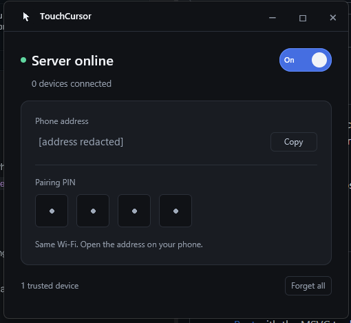

# TouchCursor

TouchCursor is a performance-focused minimal mouse controller that allows you to smoothly control your computer's mouse from your phone's browser, no app required.

It pairs a native Windows host app with a touch-optimized web trackpad served over your local network.

<p align="center">
  
  <br />
  <sub>Phone address and pairing PIN redacted.</sub>
</p>

## Quick Start

### Requirements
- Windows
- [Rust](https://www.rust-lang.org/) with the MSVC toolchain (`x86_64-pc-windows-msvc`)
- Windows SDK resource compiler (`rc.exe`)

### Run
Double-click `start.bat` to build and start TouchCursor, or launch it manually:

```powershell
cargo run --release
```

Closing the window keeps TouchCursor running in the system tray. To exit, right-click the tray icon and select **Quit app**.

## Pairing

1. Join the same Wi-Fi network on your phone and PC.
2. Open the address shown in the desktop window (for example, `http://192.168.1.15:8765`).
3. Enter the 4-digit PIN.

The browser saves an authorization token on first connection, letting you reconnect later without entering the PIN again.

## Gestures

- **One finger**: Drag to move the cursor; tap for left-click, double-tap for double-click, or press and hold for right-click.
- **Two fingers**: Drag vertically to scroll.
- **Click bar**: Tap the bottom buttons for direct left and right clicks.
- **Settings**: Adjust pointer speed, view gestures, or disconnect.

## Input & Networking

- Touch inputs stream over a persistent WebSocket rather than individual HTTP requests.
- Motion updates sample once per display frame to align with your device's refresh rate.
- Congested networks drop unsent motion frames instead of buffering stale cursor events.

## Security

Traffic travels over unencrypted HTTP and WebSockets for local network use. Only run TouchCursor on trusted private networks, and never forward port 8765 to the internet.
